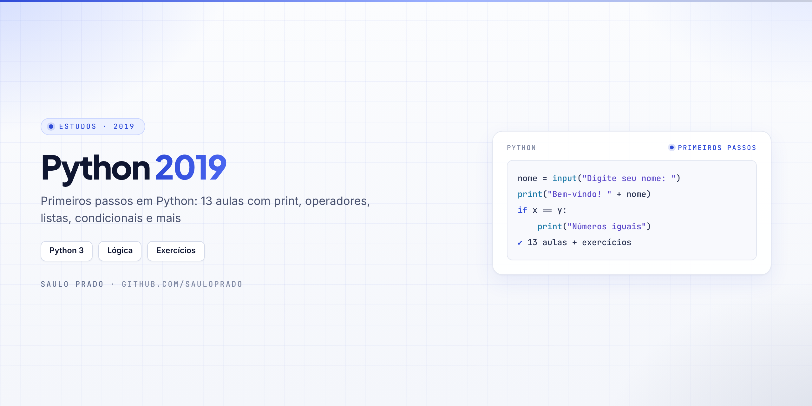

<p align="center">

</p>

<h1 align="center">Python 2019</h1>
<p align="center"><i>Primeiros passos em Python: 13 aulas e exercícios</i></p>

<p align="center">


</p>

## Sumário

- [Sobre](#sobre)
- [O que foi praticado](#o-que-foi-praticado)
- [Como visualizar](#como-visualizar)
- [Estrutura do repositório](#estrutura-do-repositório)
- [Autor](#autor)

## Sobre

Meus **primeiros estudos de Python** (2019): aulas numeradas e exercícios cobrindo a base da linguagem, até um primeiro contato com leitura de páginas da web.

## O que foi praticado

| Arquivos | Conceito |
| --- | --- |
| `aula01.py` … `aula13.py` | Sequência de aulas: saída, variáveis, cálculos, condicionais e entrada de dados |
| `print.py` · `string.py` · `concatenacao.py` | Saída de dados e textos |
| `operadores.py` · `operacoes_2.py` · `operacoes_3.py` | Operadores e cálculos |
| `listas.py` · `lista2.py` | Listas |
| `se.py` | Condicionais (`if`) |
| `os.py` | Módulo `os` |
| `dados_internet.py` | Leitura de uma página web com `urllib` |
| `ex1.py` · `ex2.py` | Exercícios |

## Como visualizar

```bash
git clone https://github.com/sauloprado/Python.git
cd Python
python aula01.py
```

## Estrutura do repositório

```text
Python/
├── aula01.py … aula13.py
├── print.py · string.py · concatenacao.py
├── operadores.py · operacoes_2.py · operacoes_3.py
├── listas.py · lista2.py · se.py · os.py
├── dados_internet.py
├── ex1.py · ex2.py
└── assets/capa.png
```

## Autor

**Saulo Prado** · Analista de Sistemas · Gestão de Ativos de TI, orçamento, automação e dashboards

[](https://www.linkedin.com/in/saulo-prado-ab4a0b96/)
[](https://github.com/sauloprado)
